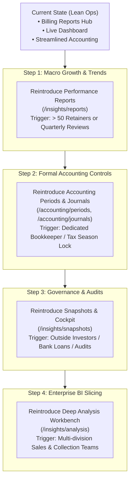

# Hidden Pages, Deferred Features & Clean Architecture Roadmap

> **Status:** Current operational architecture (October 2026)  
> **Audience:** PMG Engineering, Product, and Finance Operators  
> **Context:** Navigation decluttering and workspace consolidation for Playhouse Media Group (PMG Hub)

---

## 1. Executive Summary

As a growing boutique digital agency and tech studio, operational clarity and speed are paramount. Over-instrumented enterprise software often introduces redundant analytical portals, duplicated tables, and cognitive friction that slows down day-to-day cash flow management.

To streamline the PMG Hub admin experience:
- We consolidated daily revenue operations into a single unified **Reports Hub** at [`/billing/reports`](file:///d:/websites/pmg-hub/apps/admin/src/app/(admin)/billing/reports/reports-template-client.tsx) featuring **Invoices**, **Payments**, **Expenses**, and **AR Aging** (complete with live invoice drilldown, color-coded overdue tiers, CSV exports, and printable/downloadable A4 PDFs using `pdfcn`).
- We made **`Billing > Payments`** the single authoritative destination for cash-in receipts, removing the duplicate `/finance/income` page.
- We renamed the client area to **`Relationships`** (`/relationships`), uniting **Clients**, pre-sale **Leads**, in-flight **Onboarding**, tender **Compliance Radar**, and **Public Documents** (Cloudflare R2-hosted SBD tender forms) under one roof.
- We tucked low-frequency setup catalogs (**Billing Items**, **Finance Categories**, **Chart of Accounts**, **Divisions**) and specialized tracking modules (**Assets Register**, **Savings Goals**) into their respective dashboards and settings workbenches.
- We collapsed the **System** footer into a direct, 1-click **Settings** launcher (`/settings`), relying on its built-in `SettingsNav` sub-sidebar.

All pages, API routes, and components remain fully functional in the codebase and reachable via deep links and breadcrumbs via `EXTRA_LABELS`.

---

## 2. Inventory of Hidden & Relocated Pages

| Route | Former Title | Category | Current Status | Why It Was Hidden / Relocated |
| :--- | :--- | :--- | :--- | :--- |
| `/finance/income` | **Income** | Finance | Hidden from sidebar | 100% duplicate of `Billing > Payments`. Both query `getAllIncome` and payment allocations. Billing is authoritative for revenue cash-in. |
| `/documents` | **Public Documents** | System | Relocated to Relationships | SBD tender bidding documents downloaded by prospective leads. Sits naturally alongside Compliance Radar. |
| `/projects/list` | **Schedule List** | Projects | Hidden from sidebar | Redundant with the Projects overview and Timeline view. |
| `/finance/categories` | **Finance Categories** | Finance | Hidden from sidebar | Expense category taxonomy. Configured once; managed via Expenses or settings. |
| `/assets` | **Assets Register** | Finance | Hidden from sidebar | Crypto Luno and physical hardware ledger. Accessible via Finance Overview. |
| `/savings` | **Savings Goals** | Finance | Hidden from sidebar | Specialized savings target tracker. Accessible via Finance Overview. |
| `/accounting/chart-of-accounts` | **Chart of Accounts** | Accounting | Hidden from sidebar | Double-entry account taxonomy. Accessible directly from `/accounting` overview. |
| `/accounting/journals` | **Manual Journals** | Accounting | Hidden from sidebar | Manual debit/credit journal entry posting. 99% of entries are auto-posted from Invoices and Expenses. Still accessible from `/accounting` overview dashboard. |
| `/accounting/trial-balance` | **Trial Balance** | Accounting | Hidden from sidebar | End-of-year verification report for accountants ensuring debits equal credits before tax filings. Still accessible from `/accounting` overview balance widget. |
| `/accounting/periods` | **Accounting Periods** | Accounting | Hidden from sidebar | Manual month-end close/lock management with retroactive edit locks and grace periods. PMG currently relies on automated daily cron jobs; manual book locking is unnecessary overhead for a 1–2 person ops team. |
| `/billing/aging` | **Aging Report (Standalone)** | Billing | Replaced | Standalone page superseded by the consolidated AR Aging view inside `/billing/reports`. (Route remains active via `EXTRA_LABELS` for deep-link compatibility). |
| `/insights/reports` | **Performance Reports** | Analytics | Hidden from sidebar | Displays macro time-series charts (revenue invoiced vs received). At PMG's current size, monthly cash flow is already monitored directly on the main Dashboard and in the Billing Reports table. |
| `/insights/snapshots` | **Snapshots Cockpit** | Auditing | Hidden from sidebar | Freezes point-in-time financial states with historical diffing. Useful for formal statutory audits or venture capital reporting, but redundant when live general ledger queries are always accurate. |
| `/insights/financial-reports` | **Financial Reports** | Reporting | Hidden from sidebar | Card-based shortcuts linking to P&L, Balance Sheet, and Trial Balance. 100% duplicated by the dedicated **Accounting** group in the sidebar (`/accounting/*`). |
| `/insights/analysis` | **Business Analysis** | Analytics | Hidden from sidebar | Multidimensional AR workbench with secondary matrix filters and status chips. 90% of its utility is now directly served by the faster, cleaner `/billing/reports` Aging tab. |

---

## 3. Detailed Breakdown: Why They Were Hidden

### 1. `/finance/income` vs `/billing/payments` (Duplicate Cash-In)
- **What it does:** Both pages query client invoice payment allocations to display money collected.
- **Why consolidated:** Having "Payments" under Billing and "Income" under Finance forces operators to maintain two mental models for the same financial event. `Billing > Payments` is the operational truth for client payment records. Finance is now dedicated strictly to money out (**Expenses** and **Recurring bills**).

### 2. `/billing/items` (Service Catalog)
- **What it does:** Stores hourly billing rates and standardized quote/invoice items.
- **Why deferred:** Once predefined items and agency hourly rates are set up, this page is touched once a quarter at most. It creates menu clutter when placed between daily operational documents.

### 3. `/relationships/divisions` (Corporate Brand Divisions)
- **What it does:** Lists PMG's core operating divisions (Playhouse Media Group, TenderEdge Solutions, Apex Web Solutions).
- **Why deferred:** Divisions are structural company entities, not individual client accounts. Placing them in the CRM menu cluttered daily client relationship workflows.

### 4. `/documents` (Relocated to Relationships)
- **What it does:** Hosts Standard Bidding Documents (SBD forms) on Cloudflare R2 and tracks lead download counts.
- **Why relocated:** Previously buried under System/Settings, these documents are sales enablement tools for tender leads. Placing them in **Relationships** next to Compliance Radar groups all bid-readiness tools together.

### 5. `/projects/list` (Schedule List)
- **What it does:** Tabular list of all project schedule entries.
- **Why deferred:** Operators primarily navigate project health through the **Projects Overview** (workload & at-risk tenders) and the visual **Timeline**. The list view remains accessible via the overview and direct URL.

### 6. `/accounting/chart-of-accounts`, `/accounting/journals`, `/accounting/trial-balance`
- **What they do:** Deep double-entry accounting mechanics (account taxonomy, manual journal adjustments, debit/credit parity).
- **Why deferred:** Small boutique agencies run on automated ledger posting (invoices auto-post revenue, expense logging auto-posts operating costs). Day-to-day operators care about **Profit & Loss** for net margins and **General Ledger** for transaction audits. All three pages remain directly linked from the `/accounting` overview dashboard.

---

## 4. Reintroduction Roadmap & Growth Triggers

When PMG scales, certain controls and macro analytics will become valuable again. Below is the recommended sequence and the operational triggers for bringing each page back:



---

## 5. How to Reactivate Any Page

All pages, controllers, API routes, and components remain fully functional in the codebase. To unhide any route, simply edit [`apps/admin/src/components/navigation/nav-data.ts`](file:///d:/websites/pmg-hub/apps/admin/src/components/navigation/nav-data.ts):

Add the item back to your chosen group in `GROUPS`:
```typescript
// apps/admin/src/components/navigation/nav-data.ts

{
  key: 'finance',
  label: 'Finance',
  icon: Banknote,
  items: [
    { title: 'Overview', url: '/finance', icon: LayoutGrid },
    { title: 'Income', url: '/finance/income', icon: ArrowDownLeft }, // <-- Unhide here
    { title: 'Expenses', url: '/finance/expenses', icon: TrendingDown },
    { title: 'Recurring', url: '/finance/recurring', icon: CalendarClock },
  ],
}
```

---

## 6. Summary of Current Clean Architecture

```
PMG Hub Admin (Active Navigation)
│
├── Dashboard (/dashboard)
│
├── Billing
│   ├── Overview (/billing)
│   ├── Quotations (/billing/quotes)
│   ├── Invoices (/billing/invoices)
│   ├── Payments (/billing/payments) ─── [Authoritative cash-in records]
│   ├── Credits (/billing/credits)
│   ├── Statements (/billing/statements)
│   ├── Reports (/billing/reports) ─── [Invoices | Payments | Expenses | AR Aging]
│   └── Billing Items (/billing/items)
│
├── Relationships
│   ├── Overview (/relationships)
│   ├── Clients (/relationships/clients)
│   ├── Leads (/relationships/leads)
│   ├── Onboarding (/relationships/onboarding)
│   ├── Divisions (/relationships/divisions)
│   ├── Compliance Radar (/insights/compliance-radar)
│   └── Public Documents (/documents)
│
├── Projects
│   ├── Overview (/projects)
│   └── Timeline (/projects/timeline)
│
├── Finance
│   ├── Overview (/finance)
│   ├── Expenses (/finance/expenses)
│   └── Recurring (/finance/recurring)
│
├── Accounting
│   ├── Overview (/accounting)
│   ├── Profit & Loss (/accounting/profit-and-loss)
│   └── General Ledger (/accounting/general-ledger)
│
└── System
    └── Settings (/settings) ─── [Internal secondary sidebar with 10 settings panels]
```
