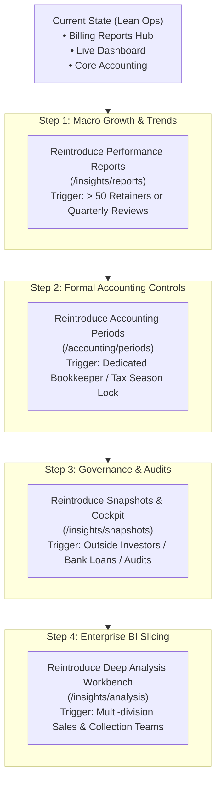

# Hidden Reports & Reintroduction Roadmap

> **Status:** Current operational architecture (October 2026)  
> **Audience:** PMG Engineering, Product, and Finance Operators  
> **Context:** Navigation decluttering and reporting consolidation for Playhouse Media Group (PMG Hub)

---

## 1. Executive Summary

As a growing boutique digital agency and tech studio, operational clarity and speed are paramount. Over-instrumented enterprise software often introduces redundant analytical portals, duplicated tables, and cognitive friction that slows down day-to-day cash flow management.

To streamline the PMG Hub admin experience:
- We consolidated daily revenue operations into a single unified **Reports Hub** at [`/billing/reports`](file:///d:/websites/pmg-hub/apps/admin/src/app/(admin)/billing/reports/reports-template-client.tsx) featuring **Invoices**, **Payments**, **Expenses**, and **AR Aging** (complete with live invoice drilldown, color-coded overdue tiers, CSV exports, and printable/downloadable A4 PDFs using `pdfcn`).
- We relocated **Compliance Radar** directly under **Clients** (`/relationships`), keeping critical tax and compliance deadlines right where client accounts are managed.
- We hid 5 redundant or enterprise-heavy analytical pages from the sidebar without deleting code or breaking URLs.

This document details all pages hidden, why they were deferred, the concrete business growth triggers that justify their return, their preferred reintroduction sequence, and the exact steps to reactivate them.

---

## 2. Inventory of Hidden Pages

| Route | Former Title | Category | Current Status | Why It Was Hidden |
| :--- | :--- | :--- | :--- | :--- |
| `/insights/reports` | **Performance Reports** | Analytics | Hidden from sidebar | Displays macro time-series charts (revenue invoiced vs received). At PMG's current size, monthly cash flow is already monitored directly on the main Dashboard and in the Billing Reports table. |
| `/accounting/periods` | **Accounting Periods** | Accounting | Hidden from sidebar | Manual month-end close/lock management with retroactive edit locks and grace periods. PMG currently relies on automated daily cron jobs; manual book locking is unnecessary overhead for a 1–2 person ops team. |
| `/insights/snapshots` | **Snapshots Cockpit** | Auditing | Hidden from sidebar | Freezes point-in-time financial states with historical diffing. Useful for formal statutory audits or venture capital reporting, but redundant when live general ledger queries are always accurate. |
| `/insights/financial-reports` | **Financial Reports** | Reporting | Hidden from sidebar | Card-based shortcuts linking to P&L, Balance Sheet, and Trial Balance. 100% duplicated by the dedicated **Accounting** group in the sidebar (`/accounting/*`). |
| `/insights/analysis` | **Business Analysis** | Analytics | Hidden from sidebar | Multidimensional AR workbench with secondary matrix filters and status chips. 90% of its utility is now directly served by the faster, cleaner `/billing/reports` Aging tab. |
| `/billing/aging` | **Aging Report (Standalone)** | Billing | Replaced | Standalone page superseded by the consolidated AR Aging view inside `/billing/reports`. (Route remains active via `EXTRA_LABELS` for deep-link compatibility). |

---

## 3. Detailed Breakdown: Why They Were Hidden

### 1. `/insights/reports` (Performance Reports)
- **What it does:** Visualizes historical gross billing vs actual cash collected over rolling 6–12 month windows.
- **Why deferred:** While visually engaging, charts do not collect overdue money or issue invoices. For a team managing tens of active client projects, a glance at the `/dashboard` summary metrics or running a 1-click `/billing/reports` statement provides immediate, actionable answers without navigating to a separate graphing page.

### 2. `/accounting/periods` (Accounting Periods & Month-End Close)
- **What it does:** Allows finance administrators to manually declare a financial period "Closed", configure lock dates, and enforce grace periods that prevent modifying older transactions.
- **Why deferred:** Month-end locking is a strict internal control designed for teams with multiple junior accountants to prevent accidental back-dating. For PMG, automated backup scripts (`/api/cron/backup-retention`) and recurring billing cron tasks keep the books current without requiring manual monthly administrative rituals.

### 3. `/insights/snapshots` (Financial Snapshots & Cockpit)
- **What it does:** Captures immutable JSON snapshots of balances across divisions and compares period-over-period variance.
- **Why deferred:** Snapshots add a layer of complexity necessary when preparing for external audit committee reviews or investor board decks. PMG’s live Drizzle ledger accounts reflect real-time financial health without needing frozen snapshots.

### 4. `/insights/financial-reports` (Reports Landing Page)
- **What it does:** A static navigation hub displaying cards pointing to Profit & Loss, Balance Sheet, and Trial Balance.
- **Why deferred:** It was an unnecessary extra click. Operators can click directly into **Profit & Loss**, **General Ledger**, or **Trial Balance** straight from the primary sidebar under **Accounting**.

### 5. `/insights/analysis` (Interactive AR Workbench)
- **What it does:** A heavy client-by-client aging grid with interactive filters and delinquency tables.
- **Why deferred:** It was fragmented from the billing flow. By embedding aging directly into `/billing/reports` with interactive invoice drilldown, colorized overdue badges, and instant PDF/CSV export, operators no longer need a separate analytical workbench.

---

## 4. Reintroduction Roadmap & Preferred Order

When PMG scales, certain controls and macro analytics will become valuable again. Below is the recommended sequence and the operational triggers for bringing each page back.



---

### Phase 1: Macro Performance & Trends (`/insights/reports`)
- **Recommended Priority:** **1st**
- **Trigger Metric:** PMG exceeds 40–50 active monthly retainers OR operations conducts formal quarterly financial reviews.
- **Operational Need:** At this volume, operators need to spot macro seasonal dips, collection lag trends, and cash burn shifts across quarters.
- **Recommended Implementation:**
  - Option A: Re-enable `/insights/reports` in the sidebar under an **Insights** group.
  - Option B (Preferred): Embed the time-series chart directly as an analytical tab inside [`/billing/reports`](file:///d:/websites/pmg-hub/apps/admin/src/app/(admin)/billing/reports/reports-template-client.tsx) so all operational reporting stays under one roof.

---

### Phase 2: Accounting Period Locking (`/accounting/periods`)
- **Recommended Priority:** **2nd**
- **Trigger Metric:** Onboarding a part-time/external bookkeeper OR filing formal year-end tax returns where prior months must remain strictly immutable.
- **Operational Need:** Once outside bookkeepers or multiple staff touch expenses and invoices, locking past periods prevents historical numbers from shifting after tax returns are submitted to SARS.
- **Recommended Placement:** In the sidebar under **Accounting** directly beneath *Profit & Loss*.

---

### Phase 3: Financial Snapshots Cockpit (`/insights/snapshots`)
- **Recommended Priority:** **3rd**
- **Trigger Metric:** Seeking commercial debt financing, applying for enterprise tender pre-qualifications requiring audited historical records, or onboarding equity partners.
- **Operational Need:** Financial institutions and external auditors require verifiable, frozen balance sheet states with clear period-over-period variance trails.
- **Recommended Placement:** Under **Accounting** as *Financial Snapshots* or in a restored **Insights** group.

---

### Phase 4: Multidimensional Analysis Workbench (`/insights/analysis`)
- **Recommended Priority:** **4th**
- **Trigger Metric:** PMG scales dedicated account managers or collections personnel who need complex slicing (e.g., cross-filtering division managers, collection risk cohorts, and custom date brackets).
- **Operational Need:** Large teams with dedicated credit control departments benefit from multidimensional pivot tables and workbench filters.
- **Recommended Placement:** Restored under **Insights** or linked as an "Advanced AR View" from `/billing/reports`.

---

## 5. How to Reactivate Any Page

All pages, controllers, API routes, and components remain fully functional in the codebase. To unhide any route, simply edit [`apps/admin/src/components/navigation/nav-data.ts`](file:///d:/websites/pmg-hub/apps/admin/src/components/navigation/nav-data.ts):

### Example: Unhiding Performance Reports
Add the item back to your chosen group in `GROUPS`:
```typescript
// apps/admin/src/components/navigation/nav-data.ts

{
  key: 'billing',
  label: 'Billing',
  icon: FileSpreadsheet,
  items: [
    { title: 'Overview', url: '/billing', icon: LayoutGrid },
    // ...
    { title: 'Reports', url: '/billing/reports', icon: BarChart3 },
    { title: 'Performance Trends', url: '/insights/reports', icon: LineChart }, // <-- Unhide here
  ],
}
```

### Example: Unhiding Accounting Periods
Add the item to the `accounting` group in `GROUPS`:
```typescript
// apps/admin/src/components/navigation/nav-data.ts

{
  key: 'accounting',
  label: 'Accounting',
  icon: Calculator,
  items: [
    { title: 'Overview', url: '/accounting', icon: LayoutGrid },
    { title: 'Chart of Accounts', url: '/accounting/chart-of-accounts', icon: BookOpen },
    { title: 'General Ledger', url: '/accounting/general-ledger', icon: BookMarked },
    { title: 'Journals', url: '/accounting/journals', icon: NotebookPen },
    { title: 'Trial Balance', url: '/accounting/trial-balance', icon: Scale },
    { title: 'Profit & Loss', url: '/accounting/profit-and-loss', icon: LineChart },
    { title: 'Accounting Periods', url: '/accounting/periods', icon: Calendar }, // <-- Unhide here
  ],
}
```

---

## 6. Summary of Current Clean Architecture

```
PMG Hub Admin (Active Navigation)
│
├── Dashboard (/dashboard)
│
├── Billing
│   ├── Overview (/billing)
│   ├── Quotations (/billing/quotes)
│   ├── Invoices (/billing/invoices)
│   ├── Payments (/billing/payments)
│   ├── Credits (/billing/credits)
│   ├── Statements (/billing/statements)
│   ├── Reports (/billing/reports) ─── [Invoices | Payments | Expenses | AR Aging]
│   └── Billing Items (/billing/items)
│
├── Clients
│   ├── Overview (/relationships)
│   ├── Clients (/relationships/clients)
│   ├── Leads (/relationships/leads)
│   ├── Onboarding (/relationships/onboarding)
│   ├── Divisions (/relationships/divisions)
│   └── Compliance Radar (/insights/compliance-radar)
│
├── Projects (/projects/*)
├── Finance (/finance/*)
├── Accounting (/accounting/*)
└── System (/settings/*)
```
